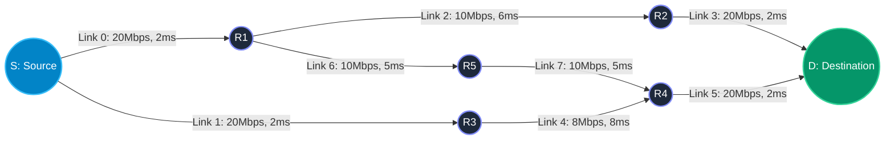

# Network Simulation Topology Specification
### Network Path and Delay Analyzer (BCSE308P Computer Networks Lab)
**Authors**: Abhik Boxi (24BCE0741) & Siddharth Saini (24BKT0121)

---

## 1. Network Topology Diagram

```
         [10.0.1.0/30]                [10.0.3.0/30]                [10.0.4.0/30]
         20Mbps, 2.0ms                10Mbps, 6.0ms                20Mbps, 2.0ms
      +----------------> [ R1 ] -------------------------> [ R2 ] ---------------+
      |                  /   \                                                    |
      |                 /     \                                                   v
    [ S ]              /       \ [10.0.7.0/30]                                  [ D ]
  (Source)            /         \ 10Mbps, 5.0ms                               (Dest)
      |              /           \                                                ^
      |             /             v                                               |
      |            /            [ R5 ]                                            |
      |           /               | [10.0.8.0/30]                                 |
      |          /                v 10Mbps, 5.0ms                                 |
      |         /               [ R4 ] -------------------------------------------+
      |        /                  ^                [10.0.6.0/30]
      |       /                   |                20Mbps, 2.0ms
      |      /                    | [10.0.5.0/30]
      |     /                     | 8Mbps, 8.0ms
      +---> [ R3 ] ---------------+
     [10.0.2.0/30]
     20Mbps, 2.0ms
```

### Mermaid Diagram


---

## 2. IP Addressing Plan & Subnet Allocations

| Link ID | Subnet CIDR | Node A | Node A IP | Node B | Node B IP | Bandwidth | Prop Delay |
| :---: | :---: | :---: | :---: | :---: | :---: | :---: | :---: |
| **0** | `10.0.1.0/30` | **S** | `10.0.1.1` (`eth0`) | **R1** | `10.0.1.2` (`eth0`) | 20 Mbps | 2.0 ms |
| **1** | `10.0.2.0/30` | **S** | `10.0.2.1` (`eth1`) | **R3** | `10.0.2.2` (`eth0`) | 20 Mbps | 2.0 ms |
| **2** | `10.0.3.0/30` | **R1** | `10.0.3.1` (`eth1`) | **R2** | `10.0.3.2` (`eth0`) | 10 Mbps | 6.0 ms |
| **3** | `10.0.4.0/30` | **R2** | `10.0.4.1` (`eth1`) | **D** | `10.0.4.2` (`eth0`) | 20 Mbps | 2.0 ms |
| **4** | `10.0.5.0/30` | **R3** | `10.0.5.1` (`eth1`) | **R4** | `10.0.5.2` (`eth0`) | 8 Mbps | 8.0 ms |
| **5** | `10.0.6.0/30` | **R4** | `10.0.6.1` (`eth1`) | **D** | `10.0.6.2` (`eth1`) | 20 Mbps | 2.0 ms |
| **6** | `10.0.7.0/30` | **R1** | `10.0.7.1` (`eth2`) | **R5** | `10.0.7.2` (`eth0`) | 10 Mbps | 5.0 ms |
| **7** | `10.0.8.0/30` | **R5** | `10.0.8.1` (`eth1`) | **R4** | `10.0.8.2` (`eth2`) | 10 Mbps | 5.0 ms |

---

## 3. Link Physical & Mathematical Properties

- **Queue Discipline**: $M/M/1/K$ Finite Queue Buffer
- **Buffer Size ($K$)**: 64 Packets per interface FIFO queue
- **Nodal Processing Delay ($d_{proc}$)**: $0.1\,\text{ms}$ fixed per hop
- **Data Packet Size ($L_{data}$)**: 1,000 bytes ($8,000\,\text{bits}$)
- **Probe Packet Size ($L_{probe}$)**: 64 bytes ($512\,\text{bits}$)
- **OSPF Cost Formula**: $\text{Cost} = \frac{\text{Reference Bandwidth}}{\text{Link Bandwidth}} = \frac{100.0\,\text{Mbps}}{R}$

| Link ID | Link Nodes | Capacity ($R$) | Service Rate ($\mu_{nom}$) | Transmission ($d_{tx}$) | Prop Delay ($d_{prop}$) | OSPF Cost | Base Util ($\rho_0$) |
| :---: | :---: | :---: | :---: | :---: | :---: | :---: | :---: |
| **0** | S - R1 | 20 Mbps | 2,500 pkt/s | 0.40 ms | 2.0 ms | 5.0 | 0.30 |
| **1** | S - R3 | 20 Mbps | 2,500 pkt/s | 0.40 ms | 2.0 ms | 5.0 | 0.30 |
| **2** | R1 - R2 | 10 Mbps | 1,250 pkt/s | 0.80 ms | 6.0 ms | 10.0 | 0.45 |
| **3** | R2 - D | 20 Mbps | 2,500 pkt/s | 0.40 ms | 2.0 ms | 5.0 | 0.30 |
| **4** | R3 - R4 | 8 Mbps | 1,000 pkt/s | 1.00 ms | 8.0 ms | 12.5 | 0.40 |
| **5** | R4 - D | 20 Mbps | 2,500 pkt/s | 0.40 ms | 2.0 ms | 5.0 | 0.30 |
| **6** | R1 - R5 | 10 Mbps | 1,250 pkt/s | 0.80 ms | 5.0 ms | 10.0 | 0.35 |
| **7** | R5 - R4 | 10 Mbps | 1,250 pkt/s | 0.80 ms | 5.0 ms | 10.0 | 0.35 |

---

## 4. End-to-End Candidate Paths Catalog

### Path P1: Upper Shortest Path (OSPF Default)
- **Sequence**: $\text{S} \to \text{R1} \to \text{R2} \to \text{D}$
- **Traversed Links**: Links 0, 2, 3
- **Total Static Cost**: $5.0 + 10.0 + 5.0 = 20.0$
- **Total Fixed Delay**: $2.0 + 6.0 + 2.0 + 3 \times 0.1\,\text{ms} = 10.3\,\text{ms}$
- **Bottleneck Capacity**: 10.0 Mbps (Link 2: R1-R2)

### Path P2: Middle Bypass Path (DAPS Primary Evasion)
- **Sequence**: $\text{S} \to \text{R3} \to \text{R4} \to \text{D}$
- **Traversed Links**: Links 1, 4, 5
- **Total Static Cost**: $5.0 + 12.5 + 5.0 = 22.5$
- **Total Fixed Delay**: $2.0 + 8.0 + 2.0 + 3 \times 0.1\,\text{ms} = 12.3\,\text{ms}$
- **Bottleneck Capacity**: 8.0 Mbps (Link 4: R3-R4)

### Path P3: Lower Transit Detour (Secondary Backup)
- **Sequence**: $\text{S} \to \text{R1} \to \text{R5} \to \text{R4} \to \text{D}$
- **Traversed Links**: Links 0, 6, 7, 5
- **Total Static Cost**: $5.0 + 10.0 + 10.0 + 5.0 = 30.0$
- **Total Fixed Delay**: $2.0 + 5.0 + 5.0 + 2.0 + 4 \times 0.1\,\text{ms} = 14.4\,\text{ms}$
- **Bottleneck Capacity**: 10.0 Mbps (Links 6 & 7)
